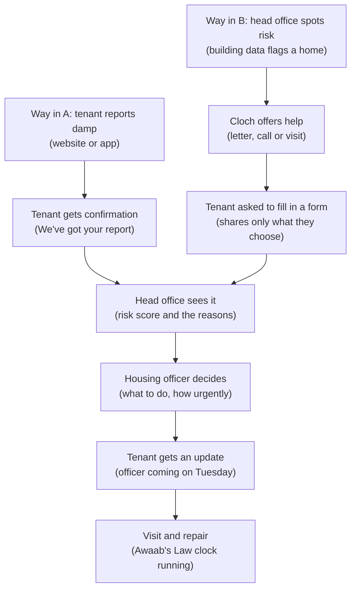

---
# Answers as codes, for counting across squads. The questions and codes are in learning/questions.md.
name: Moji Idowu
profession: Interaction Designer
role: none
location: in person
# At setup
ai_use_before: 3
hopes: [see-claude, build-fast, other-jobs]
feeling: excited
# At 19:00
worked_on: []
outside_usual_job:
got_in_way: []
ai_use_after:
# In the week after
specialist:
helped_squad: []
idea_where: []
ai_use_week_after:
---

# Moji Idowu: learning log

## At setup
- How much I use AI tools in my work today: Most weeks
- What I'm hoping to get from the hackathon: See what Claude can do; Build something real, fast; Try work outside my usual job
- How I feel about using AI in my work: Excited

## During
<!-- Claude adds one line per moment: prompts that worked (word for word), dead ends, surprises, things done outside my usual job, what made working as a squad easier or harder -->

### Summary of my day with Return of the Hacks (noted at about 18:00)

**Choosing and shaping the idea**
- We compared the three challenges, went deeper on challenge 1 (Healthier homes), and explained Awaab's Law: since 6 October 2026, landlords must investigate damp within 10 working days, send a written summary within 3, start repairs within 5 and finish within 20.
- The squad chose challenge 1. The idea has two parts that use the same data: a tenant side (report, then stay updated) and a head office side (rank homes by risk, with reasons, and a person decides).
- We looked at the balance between spotting risk early and privacy: look at homes before people, ask rather than assume, collect only what's needed, and keep a human in the loop.

**Research (`/find-out`)**
- Other landlords: regulators push a "data-driven, risk-based" approach. Building data predicts damp well without health data. Some councils have used personal data too, but none explained how they asked tenants for consent.
- Information Commissioner's Office (ICO) guidance: give privacy information in short layers at the moment you ask for data. Health information needs extra care, and it's hard for a tenant to say no freely to their own landlord.

**Mapping the journey**
- The storyline: way in A, where the tenant reports, and way in B, where head office spots risk and offers help. Both lead to review, the officer's decision, an update to the tenant, then the visit and repair.
- Claude drew the flow, and I added "Tenant asked to fill in a form".
- We drafted the tenant form questions and made a consolidated snag list.

The flow (version 2, with my form step):

The same flow as a list:

> **Way in A:** tenant reports damp → gets a confirmation
> **Way in B:** head office spots risk → Cloch offers help → tenant fills in a form, sharing only what they choose
> **Then both:** head office sees it, with a risk score and reasons → a housing officer decides → the tenant gets an update → visit and repair, with the Awaab's Law clock running

**What I built (all shared to the squad's copy)**
1. What we found (pull request 17): a short summary, then the full report, shown after the visit.
2. More report questions and photos (pull request 19): how long, what it looks like, heating costs, anyone aged 5 or under or over 65, and up to 3 photos. Head office sees the answers, and they feed the ranking.
3. In progress and past reports (pull requests 22 and 23) on the tenant's home screen.
4. Updates (notifications) and How we decide who to visit first (pull request 25).

**Still open:** round 2 snags 14 to 17 on the tenant side.

## At 19:00
- What I worked on: <answers>
- How much of it was outside my usual job: <answer>
- What got in the way: <answers>
- How much I'd use AI tools in my work now: <answer>

## In the week after
- Did I still need a human specialist: <answer>, for <what>
- What helped most when building as a squad: <answers>
- The most useful thing I learned: <in my words>
- **One idea to carry forward:** <in my words>, and where it could fit: <answers>
- How much I expect to use AI tools from now on: <answer>

## Three-week check-in (around 12 Nov)
- Did I try, share or suggest my idea anywhere? What happened, or what got in the way?
